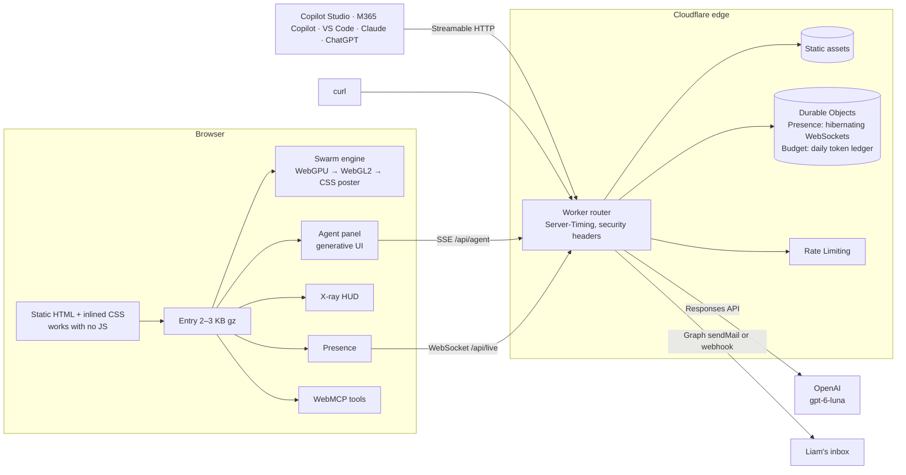

# Architecture

liamogrady.dev is designed the way Liam designs client systems: clear boundaries, graceful degradation, explicit guardrails and observable behaviour.

## Principles

| Principle | How it shows up |
|---|---|
| HTML first | Every word is server-rendered at build time. The canvas is decorative (`aria-hidden`). With JavaScript off, the site is complete. |
| Progressive capability | WebGPU compute → WebGL2 GPGPU → a pure-CSS poster. Reduced motion → still, settled frames. Save-Data → no GPU work at all. |
| Lazy by default | The entry chunk only wires events. The engine loads after `load` and idle; the agent warms on idle; X-ray, audio and presence load on demand. |
| One source of truth | `content/profile.ts` feeds the pages, the agent's grounding, the MCP server, `llms.txt`, JSON-LD and the terminal CV. |
| Least knowledge | The agent and the MCP server only know what is public. There is no client data to leak, so there is nothing to redact. |
| Degrade, don't fail | No model budget → deterministic retrieval answers in the same event format. No Worker (static preview) → the same offline agent runs in the browser. |
| Observable | Server-Timing on every Worker response, Workers Logs, and X-ray mode in the page. |

## The swarm engine

- **State:** position (xyz + tint) and velocity (xyz + energy) per particle, in storage buffers (WebGPU) or RGBA32F ping-pong textures (WebGL2).
- **Formations:** clouds of target points generated from code (orbits, dry-stone fields, a dot-matrix map with a flight path, badges, a banjo, a globe, sampled text). Each particle owns a stable, hashed target in the current and next formation; a staggered morph moves it between them along a lifted arc.
- **Forces:** critically damped spring to the target, divergence-free simplex "bitangent" flow for life, pointer repulsion, swirl around other visitors, and a shockwave on click.
- **Render:** additive HDR sprites (instanced quads on WebGPU, points on WebGL2) → 13-tap downsample and tent upsample bloom over 5 levels → ACES tone map, vignette, chromatic aberration and grain.
- **Adaptive quality:** the first two seconds are a warm-up; afterwards the active particle count adapts to measured frame time, and brightness and size are normalised so the image looks the same at 65k or 1M particles.

## The agent

- `POST /api/agent` streams Server-Sent Events. The model can call **data tools** (search the profile, get a section, assess fit, sketch an architecture) executed in the Worker, and **UI tools** (navigate, highlight, change formation, open X-ray) that the browser executes.
- Fit checks and architecture sketches return **structured cards** (JSON validated against a schema) rendered as generative UI.
- Guardrails: grounded only in public chunks, explicit refusal rules (no clients, no metrics, no prompt disclosure, pasted text treated as data), input caps, per-IP rate limiting, and a deterministic fallback.

## Security

- Strict CSP built at deploy time with SHA-256 hashes for every inline script and style; no `unsafe-inline`.
- `X-Content-Type-Options`, `Referrer-Policy`, `Permissions-Policy`, `COOP`, `frame-ancestors 'none'`.
- No cookies, no third-party trackers. Turnstile and a honeypot on the contact form.
- MCP endpoint validates `Origin`, is read-only and rate-limited.

## Budgets

| Budget | Target |
|---|---|
| JavaScript before interaction | < 5 KB gz |
| Total JavaScript | < 60 KB gz |
| CSS | < 10 KB gz, inlined |
| LCP | < 1.5 s on 4G (the H1) |
| CLS | ~0 (metric-matched font fallbacks) |
| Worker CPU per request | < 5 ms (free plan limit 10 ms) |
